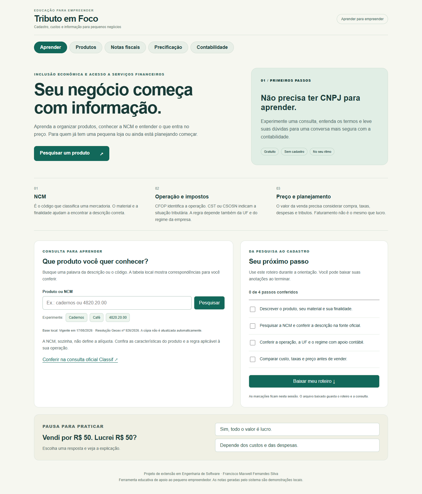

# Tributo em Foco

Projeto de extensão de **Francisco Maxwell Fernandes Silva**, do curso de Engenharia de Software, com o tema **Inclusão Econômica e Acesso a Serviços Financeiros**.

A proposta é ajudar adultos e pequenos empreendedores a organizar o cadastro de produtos, conhecer a NCM e entender como custos, taxas e tributos influenciam o preço. Quem ainda não tem empresa também pode aprender.



## O que você pode fazer

- **Aprender:** ler explicações de NCM, CFOP, CST/CSOSN e custos, pesquisar a tabela local, marcar um roteiro, baixar suas anotações e responder a um exercício sobre receita e lucro.
- **Produtos:** cadastrar mercadorias, foto, NCM, compra, venda e estoque; receber sugestões locais para revisar.
- **Precificação:** comparar loja física e virtual, incluindo pagamento, embalagem, despesas, margem e uma hipótese de tributação.
- **Notas e contabilidade:** experimentar registros, XML e remessas locais de demonstração.

A área Aprender funciona com o frontend, sem conta, CNPJ ou serviços Go. O cadastro de produtos e as outras áreas usam os dois serviços locais. As anotações marcadas na tela duram durante a sessão; baixe o roteiro para guardá-las.

## Baixar e executar

Baixe o [ZIP do projeto](https://github.com/FranciscoMaxwell/tributo-em-foco-extensao/archive/refs/heads/main.zip) ou clone:

```bash
git clone https://github.com/FranciscoMaxwell/tributo-em-foco-extensao.git
cd tributo-em-foco-extensao
```

Instale Node.js 20.19 ou superior compatível com Angular 20. No terminal:

```bash
cd frontend
npm ci
npm start
```

Abra **http://localhost:4200**. A área Aprender já estará disponível.

Para usar cadastro, estoque e simulações, instale e abra o Docker Desktop. Na pasta principal, em outro terminal:

```bash
docker compose up --build
```

Os serviços usam http://localhost:8081 e http://localhost:8082. O Docker preserva os bancos em volumes locais. Nenhum serviço fiscal externo é necessário para a demonstração.

Também é possível executar cada serviço com Go 1.22 ou superior: rode `go run .` em `backend/estoque-service` e `backend/faturamento-service`, cada um em seu terminal. Os bancos SQLite serão criados localmente.

## Como usar em uma orientação

1. Na aba Aprender, pesquise **cadernos** e confira a descrição no Classif oficial.
2. Marque as etapas que conferiu e baixe o roteiro.
3. Em Produtos, cadastre um exemplo com nome, unidade, NCM e valores de compra e venda.
4. Revise as sugestões fiscais de acordo com produto, operação, UF e regime da empresa.
5. Em Precificação, experimente os custos de uma loja física e de uma venda pela internet.

As telas incluídas no repositório usam dados fictícios para demonstração.

## De onde vêm as informações

A cópia de NCM incluída está identificada no próprio arquivo `frontend/public/data/ncm-siscomex.json`. A data e o ato aparecem na consulta. Ela **não é atualizada automaticamente**. A busca da área Aprender procura palavras ou códigos nessa cópia; uma correspondência não confirma a classificação de uma mercadoria específica.

- [Classif do Portal Único Siscomex](https://portalunico.siscomex.gov.br/classif/)
- [Classificação fiscal de mercadorias — Receita Federal](https://www.gov.br/receitafederal/pt-br/assuntos/aduana-e-comercio-exterior/classificacao-fiscal-de-mercadorias)
- [ODS 8 — Trabalho decente e crescimento econômico](https://brasil.un.org/pt-br/sdgs/8)
- [ODS 10 — Redução das desigualdades](https://brasil.un.org/pt-br/sdgs/10)

O vínculo com inclusão econômica está no acesso à informação e no planejamento do pequeno negócio. O projeto não oferece conta bancária, crédito nem aprovação de financiamento.

## Alcance e uso fiscal

As alíquotas sugeridas pelo catálogo e pelos capítulos NCM são **hipóteses educativas**, não uma apuração fiscal. A NCM sozinha não define a tributação. Antes de usar um cadastro na operação real, confira as características da mercadoria e a legislação vigente com apoio contábil.

O sistema não transmite NF-e à SEFAZ. Os estados “Autorizada” e “Contingência” pertencem à simulação local. XML e rascunhos `.eml` não têm validade fiscal e não são enviados por email. Não use certificados, senhas ou documentos reais no ambiente de demonstração.

## Tecnologias e verificação

Angular e TypeScript na interface; Go e `net/http` nos serviços; SQLite separado por serviço; Docker Compose para execução local. OCR e classificação visual são recursos opcionais da versão base e podem baixar modelos externos na primeira utilização. Esses módulos são carregados sob demanda para reduzir o carregamento inicial.

```bash
cd frontend
npm run build
npm test -- --watch=false --browsers=ChromeHeadless
```

Consulte [a descrição da adaptação](docs/PROJETO_EXTENSIONISTA.md) e [as verificações](docs/VERIFICACAO.md). O código foi adaptado de um projeto demonstrativo anterior do mesmo autor, preservando os módulos de produtos, estoque, notas e precificação e acrescentando o percurso educativo.
