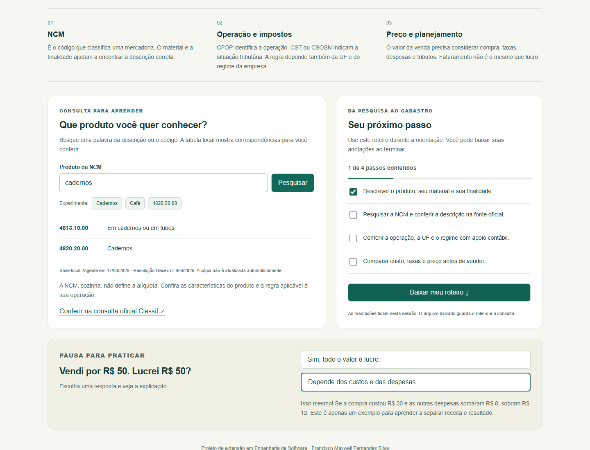
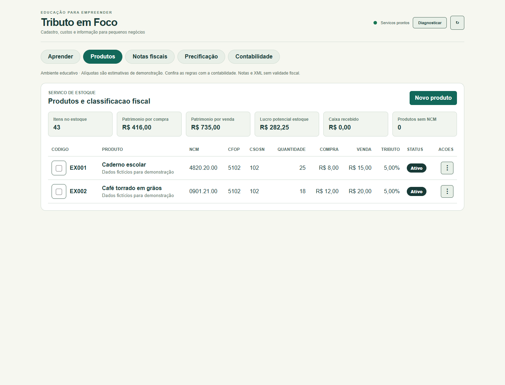
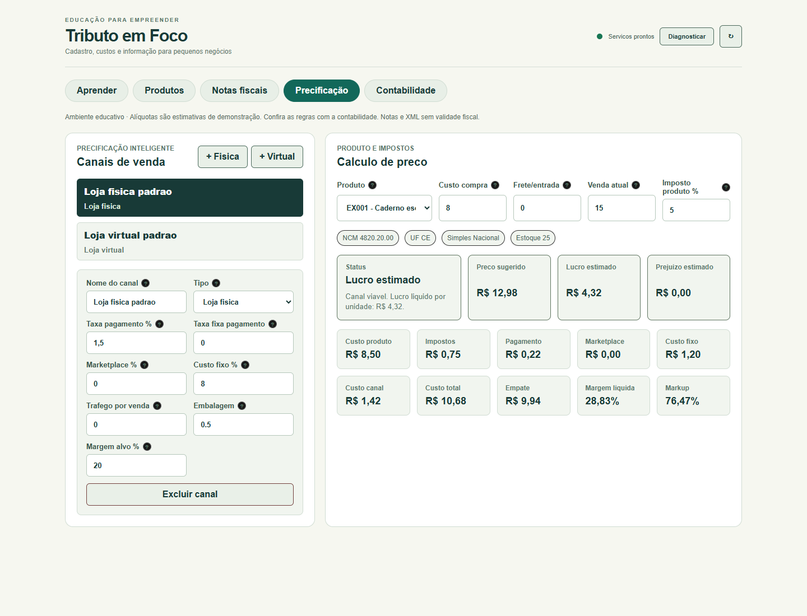

# Inclusão econômica e acesso a serviços financeiros

O Tributo em Foco aproxima pequenos empreendedores das informações necessárias para organizar produtos e planejar preços. A ação reúne orientação sobre cadastro, pesquisa de NCM e leitura dos custos de uma venda. O sistema pode ser baixado gratuitamente e também atende quem está planejando abrir um negócio.

A contribuição para o tema é educativa: entender o próprio negócio ajuda a conversar com a contabilidade e a organizar informações para decisões financeiras. O projeto não realiza intermediação bancária nem garante crédito ou regularidade fiscal.

## O que mudou nesta versão

A identidade visual recebeu cores claras, contraste em verde e navegação adaptada ao celular. A antiga identificação voltada a um teste empresarial foi substituída pelo nome Tributo em Foco e pelo contexto de extensão universitária.

A nova aba Aprender reúne explicações, consulta de NCM por palavras ou código, exemplos, roteiro com quatro etapas, exportação de anotações e uma pergunta sobre faturamento e lucro com retorno imediato. A tabela local pode ser consultada sem iniciar os serviços de cadastro e estoque.

Os recursos anteriores de cadastro, foto, estoque, precificação, notas demonstrativas e contabilidade local foram preservados. As estimativas fiscais e a ausência de validade fiscal das notas são informadas na interface e no guia de uso.

## Como consultar com cuidado

Descreva a mercadoria com material e finalidade. Pesquise o código e compare o texto com a classificação oficial. Depois confira operação, UF, regime e demais condições aplicáveis com apoio contábil. A simples semelhança entre nomes não confirma a NCM, e o código não determina sozinho os impostos devidos.

## Evidências do projeto

Consulta de NCM com roteiro de conferência e exercício educativo.

Cadastro de exemplos fictícios para demonstrar estoque, compra e venda.

Simulação de preço com custos e despesas de um canal de venda.

As capturas documentam o funcionamento da versão preparada. Não representam depoimentos ou registros de atendimento dos participantes.
